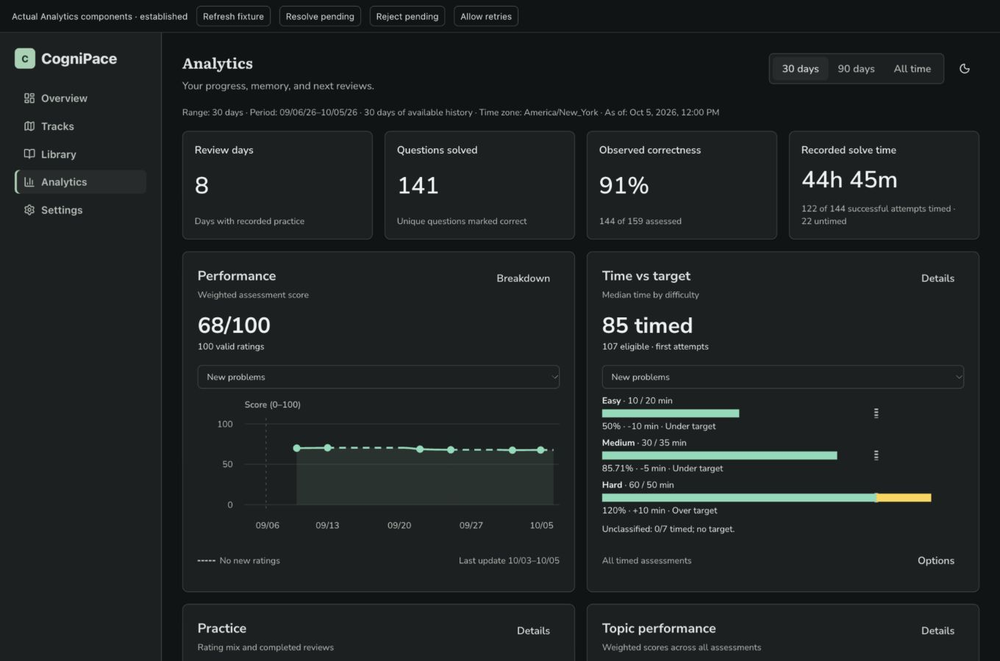
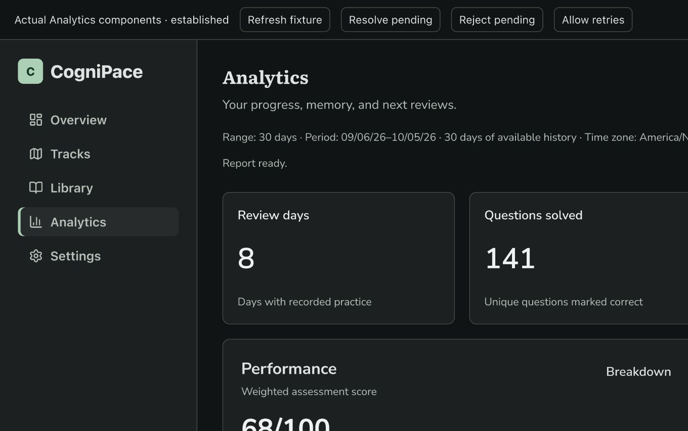
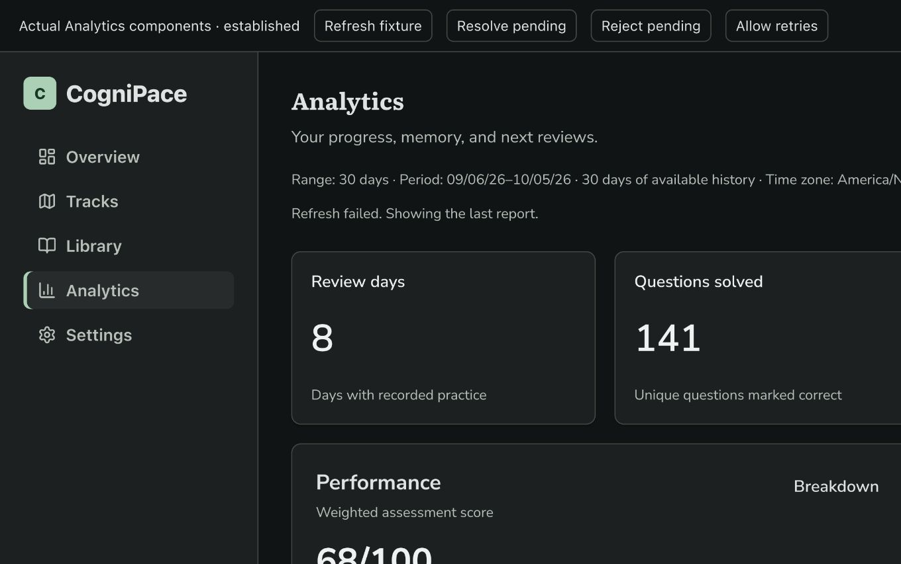

# Analytics Performance And Layout Handoff

Status: locally implemented, independently reviewed, and validated. No PR, merge, or deployment was requested. Human installed-extension smoke/proof remains pending before PR review or merge.

## Delivered behavior

- Four selected-period activity totals: review days, unique solved questions, persisted observed correctness, and recorded successful solve time with timing coverage. Empty, known zero, and unavailable remain distinct.
- Ten equal cards in the approved order, with concise descriptions and charts fitted to the card: Performance/Time, Practice/Topics, Recall/Memory, Retention/Signals, Backlog/Upcoming. Local Analytics typography retains original font licenses.
- Difficulty-weighted Performance uses Again 0, Hard 50, Good 80, Easy 100 and question weights 1/2/3. Recall keeps paired repeat-review evidence separate. Cumulative curves hold their last observed value during inactivity, with dashed holds and no fabricated observations.
- 30 days, 90 days, and All time use available history; young history keeps the selected range while displaying its actual available dates. Recall uses its own paired-history frame. Current Retention/Signals, last-30-day Backlog, and next-14-day Upcoming keep independent scopes.
- Time bars show actual target-relative duration; weighted topic scores retain raw outcomes, difficulty breakdowns and goals in Details. Backlog is green strictly below the watch threshold and amber at/above it. Complete Retention/Signals rows and all existing target actions remain reachable. Tooltip redesign stays deferred.

## Verification scope

The user subsequently prioritized full-size desktop and requested no more exhaustive layout/accessibility testing. Remaining verification focuses on desktop states, data correctness, interactions, and mandatory automated gates. Existing completed responsive evidence is retained; no additional narrow-screen matrix is planned.

Agent proof uses actual production components and validated service fixtures, not the illustrative prototype. Desktop at 1360px fits all ten 464px cards and four 148px headlines with fonts loaded. Established 30/90/All, young 12-day history, genuine old paired reviews, empty/known-zero/unknown correctness, missing/partial timing, singleton and instant-pair fixtures were inspected. The illustrative prototype's ~89% FSRS average is not substituted for actual producer values.



## Validation

Assembly focused validation passed 21 files / 465 tests; state/action coverage passed 79 relevant tests and the route timing correction passed 62/62. Fresh phase SPEC/QUALITY and final end-to-end QUALITY reviews passed. All final required commands below exited0 using pinned Node 24.20.0 / npm 11.19.0:

```sh
rtk proxy env PATH="/Users/tobiolutimehin/.nvm/versions/node/v24.20.0/bin:$PATH" npm run format
rtk proxy env PATH="/Users/tobiolutimehin/.nvm/versions/node/v24.20.0/bin:$PATH" npm run lint
rtk proxy env PATH="/Users/tobiolutimehin/.nvm/versions/node/v24.20.0/bin:$PATH" npm run check
rtk proxy env PATH="/Users/tobiolutimehin/.nvm/versions/node/v24.20.0/bin:$PATH" npm run build
rtk git diff --check
```

`check` includes database consistency, WXT preparation/TypeScript, lint and the full suite: **236 files passed / 2 skipped; 3,459 tests passed / 9 skipped**. The skipped suites are the existing opt-in live analysis/hint provider evaluations; no live provider evaluation was requested. The production Chrome MV3 build passed (5.1 MB total), preserving local font assets/licenses and existing permission/dependency/persistence boundaries. The dashboard chunk is 836.05KB and emits the existing >500KB build warning. Existing jsdom `Window.scrollTo()` notices do not fail tests.

The first final `npm run check` failed one route test that clicked the disabled loading placeholder before real query data was ready (3,458 passed, 1 failed). The correction waits for enabled Performance Details and preserves every recommendation/search-context assertion; its 62-test route suite and the subsequent full check pass. This was a test readiness correction; application hashes were unchanged. No failure is hidden.

`npm run db:generate` was skipped because no persisted schema changed. Standalone `npm run db:check` and `npm run typecheck` were not repeated at the final step because `check` runs both. `npm run zip`, release/store checks, PR creation, merge and deployment were not selected because no packaging or release action was requested. Further exhaustive narrow-screen/accessibility testing was stopped under the user's explicit scope update.

Final desktop state proof uses actual hooks with visible controlled transport actions. Initial pending/error/Retry, incompatible 90-day transition, same-key Updating/failed refresh/recovery, and empty Light all retain four 148px and ten 464px cards with identical summary/grid positions and no region overflow. Failed refresh retains identical totals and exact scope/as-of; an incompatible request displays awaiting values. One global report announcement is separate from existing chart-inspection announcements. Native screenshots below capture the visible browser portion; DOM measurements verify the full 1360CSS viewport. They are agent fixture proof, not human extension proof.





Final source commits include `71dda6d` (page assembly) and `37cd6df` (stable states), following the reviewed history/runtime/weighted/foundation/card phases. Authority docs now match the delivered models, scopes, four totals and quiet states; all non-Analytics content was preserved.

## PR integration validation

Draft PR #206 was created in the canonical repository, `Hollowvyn/Cognipace`.
Latest `main` (`9230a709`, FSRS evidence/storage recovery) was integrated to resolve
the PR conflict. Only the handoff index needed manual resolution; both entries
were retained. The combined branch passed the same pinned `npm run format`,
`npm run check` and `npm run build` commands above: **239 files passed /2 skipped;
3,662 tests passed /9 opt-in cases skipped**. This supersedes the earlier
pre-integration total for the current PR head; earlier phase results remain
historical validation. No additional Analytics layout/a11y matrix was added.

## Required human installed-extension smoke

Pending before PR review or merge under `docs/agent-governance.md` and `docs/testing.md`. Agent fixture screenshots supplement this gate. A human engineer must rebuild/load the extension and attach realtime screenshot or recording proof for:

- Desktop 30/90/All happy path, truthful four totals and independent metric scopes.
- Sparse/young/empty, unknown correctness, and missing/partial successful timing.
- All Details/raw evidence, complete Retention/Signals rows, chart inspection and Retention selection/zoom/pan/reset.
- Goal save/cancel/invalid/failed save, preserved drafts and refresh behavior.
- Initial loading/error/Retry, range transition, same-key refresh and failed-refresh retention without page movement; both themes.

No human proof is fabricated or marked N/A.
